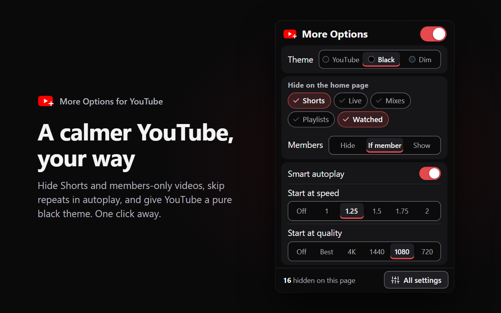

<div align="center">
  

  # More Options for YouTube

  A calmer YouTube for Firefox, Zen, Chrome and Safari: hide what you never want to see, and make the player start your way.

  [](manifest.json)
  [](#install)
  [](#install)
  [](docs/safari.md)
  [](manifest.json)
  [](#privacy)
  [](LICENSE)
  [](https://ko-fi.com/maxaubert)

  [Install](#install) · [Features](#features) · [Support](#support) · [Store text](docs/store-listing.md)
</div>

YouTube decides a lot for you: Shorts everywhere, videos that turn out to be members-only, autoplay that
loops the same five videos, previews that start the moment your mouse rests on a thumbnail. More Options
for YouTube gives each of those a switch. Everything runs in your browser, with no account and nothing
sent anywhere.

<p align="center">
  
</p>

## Features

**Hide what you never want to see**
- Shorts, Playables, news and trending rows, live and upcoming streams, mixes and playlists, one switch each.
- Members-only videos: the ones that look normal until you click and hit a paywall. By default you only
  see them from channels you are a paying member of; you can also always hide or always show them.
- Videos older than an age you pick, with fewer views than a number you pick, or already watched past a
  percentage you pick.
- Channels (name or @handle) and title words you list, or straight from a video's ⋮ menu with
  **Block channel**.
- Filter a channel by title: show only one series from a channel, or hide some of its titles.
- On the home page. One switch adds Search, Subscriptions and the list next to a video (off by default).

**A tidier grid**
- Choose how many videos per row; tiles grow past YouTube's usual 700 px cap.
- Hide titles, channel names, channel icons, or views, dates and likes, one switch each.
- No previews on hover: thumbnails stay still.

**Your player, your defaults**
- Autoplay that skips videos you have already watched or played, so it stops looping.
- Start every video at your speed and quality, and in theater mode.
- Subtitles always off, always Norwegian or always English (auto-translated when a video has no such track).
- Open Shorts in the normal player, hide end cards, hide comments.

Reads YouTube in English and Norwegian. The popup uses large, high-contrast type.

## Install

**From the stores:** both are in review (November 2026).
- Firefox and Zen: addons.mozilla.org
- Chrome and Edge: [Chrome Web Store](https://chromewebstore.google.com/detail/igjngbapajhfjnbldgacaajdccpfnfcp)

**Firefox and Zen, from source:**
1. `npm install`
2. `npm run dev` opens a throwaway Firefox profile with the add-on loaded, or load `manifest.json` from
   `about:debugging` → This Firefox → Load Temporary Add-on (removed again when the browser restarts).

Needs Firefox or Zen 142 or newer.

**Chrome, Edge, Brave** (from source):
1. `npm install`, then `npm run build:chrome`. This makes `dist/chrome` and a zip for the Chrome Web Store
   in `web-ext-artifacts/`.
2. Open `chrome://extensions`, turn on Developer mode, choose **Load unpacked** and pick `dist/chrome`.

Needs Chrome 111 or newer (for the script that talks to the player).

**Safari:** needs a Mac with Xcode. See [docs/safari.md](docs/safari.md).

## Usage

- **Settings:** click the toolbar icon. Settings sit in four tabs: Hide, Grid, Player and Block. Every change applies immediately, no reload.
- **Hidden count:** on a page the filters cover, the bottom of the popup shows how many videos were hidden
  and why, so you can check nothing is hidden by mistake.
- **Block a channel:** open the ⋮ menu on any video and choose **Block channel**, or type names into the
  Block tab (one per line). Remove a line to unblock.
- **Filter out:** the Filter out field in the Block tab takes one rule per line. Case does not matter.
  - `@channel show "before you buy"` shows only the videos from that channel with those words in the title.
  - `@channel hide "top 10"` hides the videos from that channel with those words in the title.
  - Several words in quotes on one line match any of them: `@channel hide "top 10" "ranked"`.
  - The channel is its name or @handle. A name with spaces works too: `@Some Channel hide "live"`.
  - A line that looks wrong (no show or hide, a missing quote mark) gets a warning under the field.
  - Hidden extra: `@any hide "shorts"` (or a line with just `shorts`) hides those titles from every channel.
- **Turn it all off:** the switch at the top of the popup pauses everything, so YouTube looks exactly as
  normal.
- **Show if member:** the add-on reads your own memberships page on YouTube (youtube.com/paid_memberships)
  once a day to know which channels you pay for. The list stays in your browser. When you are logged out,
  it does not save an answer.
- **Defaults:** filters work on the home page only. Shorts and news rows are hidden, autoplay skips repeats,
  and members-only videos show only for your memberships. Everything else starts off.

## Privacy

No data leaves your browser. No accounts, no tracking, no analytics. The only request it makes is to read
your own memberships page on youtube.com (for "Show if member"), with your own YouTube session.
Settings and the list of played videos (for smart autoplay) are stored locally by the browser.

## Limits

- YouTube changes its page often; a filter can stop working until a selector is updated.
- Default quality and subtitles use YouTube's player API, which YouTube can change without notice.
- Firefox and Zen get the most testing. Chrome and Safari run the same code.
- Safari is not in the App Store. You build it on a Mac with Xcode.

## Development

Plain JavaScript, no bundler. [CLAUDE.md](CLAUDE.md) has the file map, the commands and the release steps.

```bash
npm test               # parser and rule tests (node:test, no browser)
npm run lint           # web-ext lint
npm run dev            # run in a throwaway Firefox profile
npm run build:chrome   # dist/chrome and a Chrome zip
```

When something stops being hidden, the fix is usually a selector in `src/content.js` or a phrase in
`src/parse.js`. Add a test for it.

## Support

More Options for YouTube is free. If it makes YouTube better for you, a coffee helps keep it going.

<a href="https://ko-fi.com/maxaubert"></a>

## Licence

[MIT](LICENSE). Not affiliated with or endorsed by YouTube or Google.
